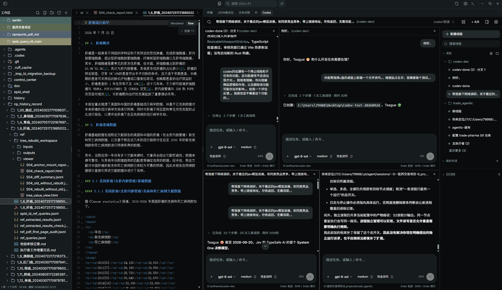

<div align="center">
  
  <h1>Codev</h1>
  <p><strong>面向多项目文件工作的高专注代码与文档阅读器</strong></p>
  <p>文件树 · 双阅读器 · 本地终端 · 多根工作区 · 插件系统</p>
</div>

> 把注意力留给业务内容，不留给软件本身。

<p align="center">
  
</p>

Codev 是一个本地优先的桌面工作台，用于同时处理多个项目中的代码、文档、日志、结构化数据与终端任务。它保留文件工作流真正需要的能力，主动移除扩展宿主、LSP、诊断、自动格式化、账号体系和常驻索引，把资源与视觉空间还给文件管理、阅读、编辑和命令行。

同一套界面里还有一层 **插件系统**。默认关闭，配置单独存放，打开后出现在 Dock（支持一键左右镜像切换）。支持 JSON 格式化、文本对照、Git 收件箱与统一 **Agent 工作区**，将本机已有的 **Pi**、**Codex**、**Antigravity** 等 Agent CLI 接入当前文件工作流，并支持通过 Tailscale 加密直连手机端远程控制。

它适合需要在多个业务目录间切换的人：项目设计、数据分析、研发协作、尽调材料、日志排查、交付文档和脚本维护。每次打开、定位、对照、复制路径、迁移文件和运行终端，都应当可见、直接、少打扰。插件系统需要时再开。

## 为什么是 Codev

### 极致轻量

Codev 的轻量仅保留文件树、阅读器、编辑器和终端。插件系统默认关闭，不进入主界面。常规 Windows 环境中已打开的 Codev 主进程工作集约为 200+ MB；同类 VS Code 之类启动后就可能达到数个 GB 的资源占用。极致轻量也是为了极致地节省人类注意力。

### 一个工作区，多个真实项目

同一窗口可以并存多个不同路径的项目根目录。每个根目录有稳定的莫兰迪色标识、独立的折叠状态与文件树；根目录默认收起，并分别记住展开状态，新加入的根目录不会自动铺开。重复路径只在同一层级去重，嵌套目录可按实际工作需要并存。

在任意项目根、目录、文件、搜索结果或文件树空白处右键，都可以选择“添加文件夹到工作区”，把新的项目加入同一个共同空间；拖入外部文件夹也会直接加入。根目录标题悬停时显示轻量删除按钮，右键菜单同样提供“从工作区移除”，只移除当前工作区引用，不会删除磁盘中的项目文件。

文件树删除进入系统回收站（包括 Windows 保留名文件也可透明安全移入回收站），误删可恢复。支持原地复制文件夹、非阻塞增量扫描属性弹窗；在文件或文件夹上右键，还可「添加到 Agent 工作区」：已有项目直接复用，不影响已打开的会话。

### 文件操作应当可感知、可中断

复制、剪切、粘贴、重命名、删除、拖拽移动和跨目录迁移都通过本地 Rust 文件层执行。迁移状态显示在文件树底部，包含进度、完成结果和失败原因；进行中的任务可中止。相同目录复制自动追加序号，避免把常见操作变成命名冲突。

### 阅读器优先于 IDE 附加负担

Codev 的中间区域只服务于内容。文本、代码、Markdown、JSON/JSONL、日志、CSV/TSV、HTML、图片、PDF 与媒体文件按各自合适的轻量方式打开；Markdown 和 HTML 支持原文/渲染切换，新打开文件的默认模式可在设置中指定。HTML 保留原页面脚本和交互；Markdown 提供动态悬浮目录。所有文本检索统一由顶部入口管理，提供词级高亮、命中计数、上下定位与替换。大 JSON/JSONL 按行窗口阅读，不把整份文件塞进编辑器。

切换标签时记住阅读位置。点击图片可全屏阅读，支持滚轮放大和拖动画幅。PDF 内部外链改到系统浏览器打开。遇到 Codev 无法解析的格式时，文件树右键「打开」和预览页按钮都会交给系统默认应用，视口只保留无法预览提示。

### 双阅读器，对照即可

“在侧边打开”将文件放入第二阅读器，与主阅读器并排。两个阅读器可独立打开、关闭和切换文件，适合对照代码、版本、方案和数据。

### 终端是工作流的一部分

终端由 Rust PTY 和 xterm.js 驱动，支持多终端、水平/垂直分屏、终端拖拽排序、重命名、当前目录追踪、搜索、链接识别和路径拖入。从文件树打开终端时，会切到终端页并进入对应目录。右侧终端树会显示当前选择态与近期输出态；终端数量不设人为上限，当前可见终端各自保留渲染槽，隐藏空闲终端按需回收。

### 插件系统与统一 Agent 工作区

文件树、阅读器和终端是产品本体。插件系统是一条可开关、可左右镜像切换的工作面：配置独立，启用后以 Dock 标签出现，可和终端一起拖拽排序。关掉以后，主界面回到原来的阅读工作台。

当前支持四项：

| 能力 | 作用 |
| --- | --- |
| 统一 Agent 工作区 | 原生整合 **Pi**、**Codex (ACP)** 与 **Antigravity (ACP)**；最多六视口并发与标题拖换；支持统一消息队列、终轮撤回重编辑、会话分叉、冷启动历史输入上翻、Pi 扩展状态条、技能 `$name` 与按需语音输入/朗读 |
| Git 收件箱 | 统一查看与筛选 GitHub 通知、Issue 与 Pull Request，支持一键打开或接入 Agent 处理 |
| JSON 格式化 | 把 JSON/JSONL 放到独立页里整理、检索、对照 |
| 文本对照 | 两段文本并排，标出差异 |

### 手机远程控制（Tailscale 加密直连）

在 **Agent 设置 → 通用 → 手机连接** 中开启服务，Codev 会自动探测本机活跃的 Tailscale 虚拟网络（`100.64.0.0/10`），无需配置公网端口或证书，通过一次性配对码即可在手机浏览器中跨网端到端加密控制本机 Agent 会话，并支持细粒度设备写权限管理与一键清空配置。

### 工作区 Git 与块级记事本

设置中开启 Git 后，可按工作区根目录查看状态、暂存、提交、拉取、推送，并在主区打开差异和提交图。这是当前文件工作流上的轻量入口，不是独立 Git 客户端。

记事本是可拖动的浮层，基于 SQLite 存储，支持行内 Markdown 渲染、项目与已完成项折叠、完成进度条、软删除回收站以及 Markdown 源码视图与导入/导出。

## 核心能力

| 领域 | 当前能力 |
| --- | --- |
| 多项目文件管理 | 多根工作区、根目录默认收起并记住展开、隐藏文件、跨层级文件名搜索、根目录右键操作、Ctrl/⌘ 多选、复制多个路径、外部拖入、文件监听自动刷新、添加到 Pi / Codex 项目 |
| 文件处理 | 新建文件/目录、复制、剪切、粘贴、重命名、删除进入回收站、拖拽移动、异步迁移进度、取消与错误反馈 |
| 阅读与编辑 | CodeMirror 6 编辑、5 秒自动保存、语法高亮、全文折叠/展开、双阅读器对照、标签来源消歧、切标签记住滚动位置、大 JSON/JSONL 分行预览、无法预览时用系统默认应用打开 |
| 文档与数据 | Markdown 与 HTML 原文/渲染及默认模式、Markdown 悬浮目录、可编辑 JSON/JSONL、纯文本日志阅读、CSV/TSV、图片全屏预览、PDF、音视频预览 |
| 统一搜索 | 顶部搜索、词级莫兰迪蓝高亮、命中计数、前后跳转、替换、代码/Markdown/HTML 原文与渲染一致接入 |
| 终端 | 本地 Shell、WSL、PTY 分屏、目录追踪、从文件树打开并切到对应目录、前台进程保护、Ctrl+C、复制粘贴、运行态提示、终端搜索 |
| 插件系统 | 默认关闭的右侧 Dock：JSON 格式化、文本对照、工作台、Pi Agent、Codex；多视口对话；技能以 `$name` 引用 |
| 工作区 Git | 绑定工作区根目录，查看状态、暂存、提交、拉取、推送及差异/提交图 |
| 记事本 | 可拖动浮层，记录一次性待办和项目待办 |
| 系统感知 | 首次欢迎页、关窗口进入托盘、完成后通知、任务栏待读角标、GitHub 更新检查 |
| 个性化 | 中文默认界面；三套内置主题——玻璃感（默认，Windows 原生毛玻璃，浅色/深色）、VSCode质感、传统黑白；字体、缩放、背景、终端光标、回滚行数与必要快捷键 |

## 设计取舍

Codev 按「当前工作集」来分配资源：文件树按需展开，阅读器优先保留当前内容，HTML 渲染页只挂载活动页，终端使用可回收的渲染槽位，文件迁移在后台执行并将状态交给界面。插件系统按开关加载；Pi 运行时按会话按需拉起，浏览历史或列出技能不必先唤醒 RPC。这些选择服务于多业务目录并行处理时的响应稳定性，也降低了阅读过程中的视觉噪声和注意力切换成本。

首次进入会看到欢迎页，说明「人类注意力优先」的定位，并自动落成文件树 / 阅读器 / 终端三栏默认布局。覆盖安装后会再次显示；安装版与便携版各自独立记录。关闭窗口进入托盘，后台任务完成后弹出 Windows 通知；托盘右键可真正退出。

为了保持这个方向，以下能力不在产品边界内：插件市场、扩展运行时、语言服务器、代码诊断、自动格式化、独立 Git 客户端、常驻全盘索引和账号遥测。工作区根目录上的状态、提交和差异只服务于当前文件工作流。需要完整 IDE 能力时，终端和外部专业工具仍然是更清晰的边界。

Pi 出现在 Dock 里，是为了把「当前这些本地路径」交给已经存在的 Pi CLI。文件拖进对话、改完在阅读区打开，这一步向 Visual Studio Code 和 Codex 学习，范围仍收在 Codev 的文件树和插件系统里。

## 架构

Codev 基于 Tauri 2。Rust 负责文件系统、监听、迁移、内容搜索、工作区授权、Windows/WSL 路径处理、`portable-pty`，以及插件系统中 Pi / Codex 所需的进程桥；React 负责文件树、阅读器、标签、终端和右侧插件 Dock；Tauri WebView 负责把两层安全地连接为一个本地应用。

```text
本地文件系统 / Shell / WSL / 可选的 Pi CLI (~/.pi) / 可选的 Codex CLI
             │
Rust: fs · watch · transfer · grep · workspace · PTY · git · pi_agent · codex_agent
             │ IPC
React: 多根文件树 · 双阅读器 · 顶部检索 · 终端导航 · 插件系统
```

架构约定与模块边界见 [CODEV.md](CODEV.md)，测试和贡献说明见 [docs/README.md](docs/README.md) 与 [CONTRIBUTING.md](CONTRIBUTING.md)。插件系统与 Pi 的专项边界见 [docs/development/pi-agent-plugin/README.md](docs/development/pi-agent-plugin/README.md)。

## 从源码运行

前置条件：Rust stable、Node.js 22+、pnpm，以及当前系统的 Tauri 构建依赖。启用 Pi Agent 时，本机还需安装 Pi Coding Agent 并配置可用模型；启用 Codex 时还需安装 Codex CLI。不启用对应插件则不必安装。

```bash
pnpm install
pnpm tauri dev
```

日常界面核验请用独立 identifier，避免和已安装的 Codev 抢单实例锁：

```bash
pnpm tauri dev --config src-tauri/tauri.portable.conf.json
```

常用校验：

```bash
pnpm check-types
pnpm test
pnpm build
cd src-tauri && cargo check --all-targets --locked
```

构建 Windows 便携版：

```bash
pnpm tauri build --config src-tauri/tauri.portable.conf.json --no-bundle
```

## 获取

当前版本为 1.1.1，提供 Windows x64 安装包和便携包，见 [GitHub Releases](https://github.com/nicheerfeng/Codev/releases)。

- 安装版与便携版标识独立，可同时运行。
- Codex 需要本机 Codex CLI；Pi 需要 Pi Coding Agent。不启用对应插件则不必安装。
- 玻璃感主题使用系统毛玻璃。若界面不透明，请确认 Windows 已开启透明效果。

## 致谢与来源

Codev 基于 [Terax AI](https://github.com/crynta/terax-ai) 的开源基础发展而来。感谢 Terax AI 的开发者和贡献者为 Tauri 桌面架构、跨平台终端、Shell 集成与本地工作流奠定的基础。Codev 在此基础上持续做减法与重组，形成面向多项目文件处理和高专注阅读的独立产品方向。

Pi Agent 作为插件系统的代表产品，对接 [Pi Coding Agent](https://github.com/badlogic/pi-mono) 的原生配置与 RPC。文件与 Agent 对话的衔接，向 Visual Studio Code 与 Codex 学习。

项目遵循 Apache-2.0 License。原始版权与许可证声明持续保留在 [LICENSE](LICENSE) 中。
